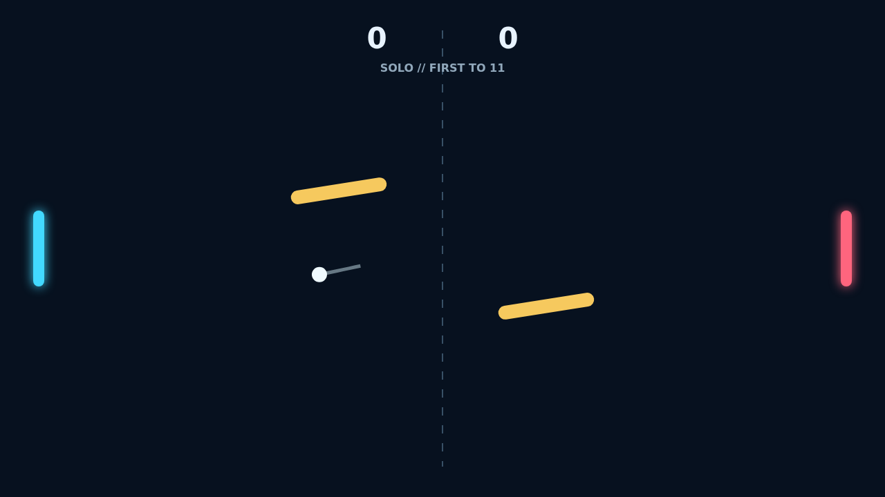

# Carom

Carom begins with a clean serve across a dark, electric court. Blue and coral
paddles face one another while a pair of golden gates slowly sway and turn in
the middle of every rally.

Meet the ball with a moving paddle to load it with spin, then watch its path
curl through the court. The fastest answers are not always straight: a well
placed bank shot can turn a defended lane into an opening.

Solo pits you against a quick tracking opponent, while Versus puts both paddles
on one keyboard. First to eleven wins, but at match point the two-point lead
keeps every final exchange alive.

